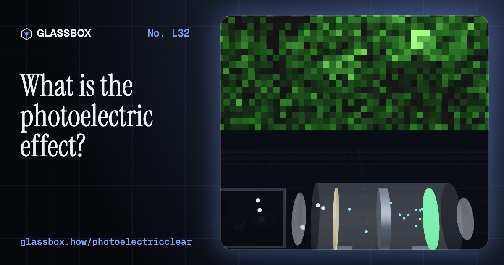
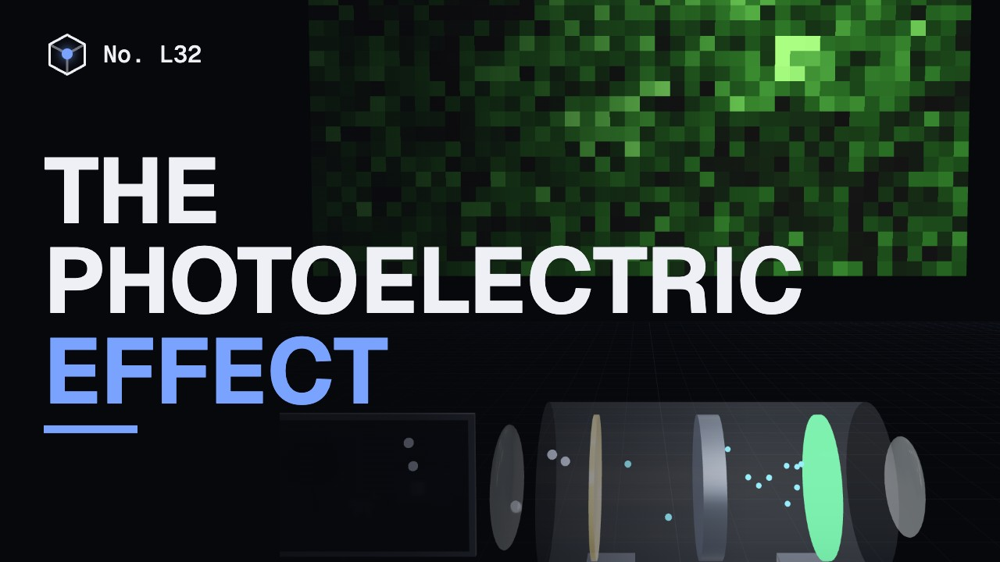
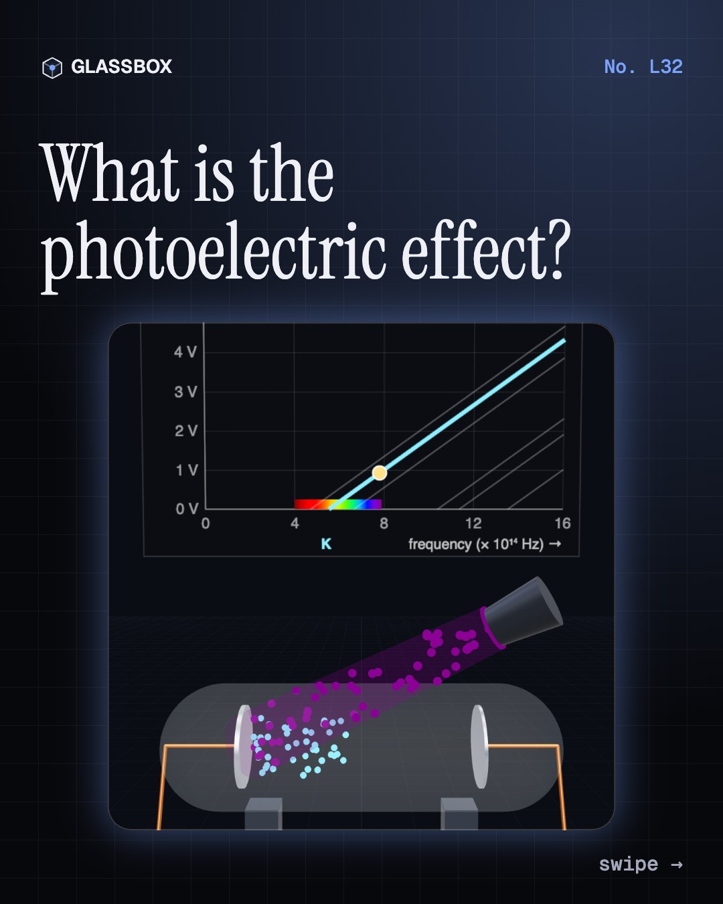
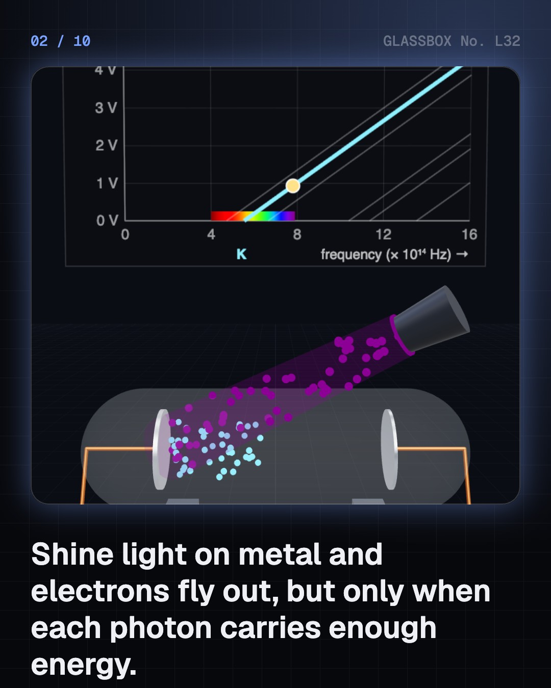
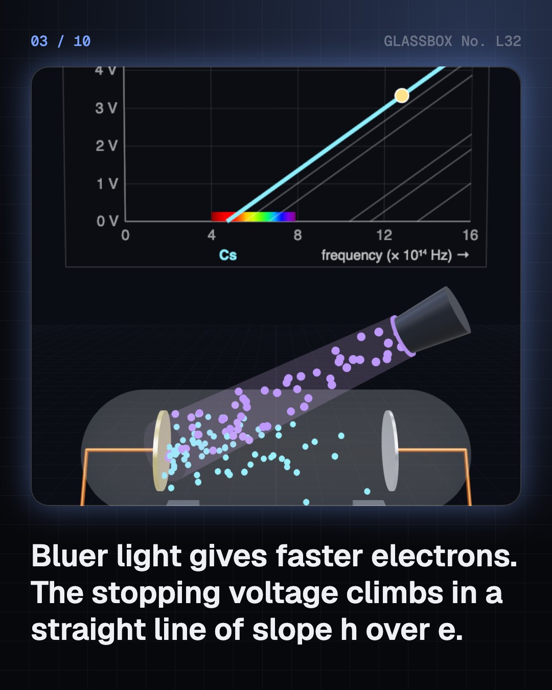
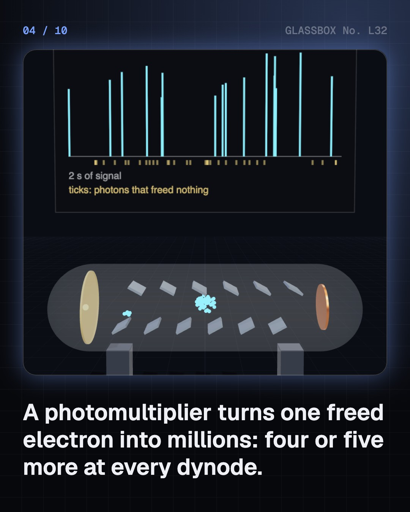

<!-- glassbox:start -->
<!-- Generated from glassbox.json by the Glassbox hub (npm run readme -- photoelectricclear). Edit glassbox.json, not this block. -->
<p align="center"><a href="https://glassbox.how/e/photoelectricclear/"></a></p>

<h1 align="center">The photoelectric effect</h1>

<p align="center"><b>What is the photoelectric effect?</b><br>Shine red light on zinc and nothing happens, however bright. Shine a little ultraviolet and electrons fly out at once. Run the experiment that won Einstein his Nobel Prize, find Planck's constant from a straight line, then see the same idea inside night-vision goggles, lift doors, camera sensors and solar panels.</p>

<p align="center"><a href="https://glassbox.how/photoelectricclear/"><b>▶ Play with it</b></a> &nbsp;·&nbsp; <a href="https://glassbox.how/e/photoelectricclear/">Read the 60-second explainer</a> &nbsp;·&nbsp; <a href="https://glassbox.how/photoelectricclear/glassbox/reel.mp4">Watch the 40-second video</a></p>

<p align="center">
  <a href="https://glassbox.how/e/photoelectricclear/"></a>
  <a href="https://glassbox.how/e/photoelectricclear/"></a>
  <a href="LICENSE"></a>
  <a href="LICENSE-CONTENT.md"></a>
  <a href="#privacy"></a>
</p>

## In 60 seconds

1. **The experiment.** Light on a clean metal plate in a vacuum knocks out electrons. Each photon carries E = hf; an electron spends the work function φ getting out and keeps at most hf − φ. Below the threshold frequency nothing comes out, however bright the light. Above it, brightness sets how many electrons and colour sets how fast. The stopping voltage rises in a straight line with frequency, with slope h ÷ e.
2. **Counting photons.** A photomultiplier frees one electron per photon caught, then multiplies it 4 or 5 times at each of ten or so dynodes: a gain of millions. Dim light shows up as separate clicks. Night-vision goggles do the same across a whole picture with a microchannel plate, and the grain you see is single photons.
3. **Light as a switch.** Inside a semiconductor a photon frees an electron without throwing it out: the internal photoelectric effect. The threshold is the band gap, 1.12 eV for silicon, so it sees infrared up to 1,107 nm. That runs lift-door beams and TV remotes. A street light's sensor is a strip whose resistance climbs as daylight fades.
4. **Solar cells and camera pixels.** A solar cell uses the related photovoltaic effect: light frees electrons and holes inside silicon and a p–n junction steers them round a circuit. Photons below the gap pass through and spare energy becomes heat, leaving 44 % at best; real panels manage about 21 %. A camera pixel stores one electron per photon, with a random wobble of √N.
5. **Limits and a myth.** A wave would need seconds or hours to free an electron in dim light; in fact it takes under 3 billionths of a second. Power counts photons, frequency decides what each can do: a 1,000 W microwave oven's photons cannot break one bond. Intense lasers bend the rule by delivering several photons at once.

## Words worth knowing

| Term | Meaning |
|---|---|
| **Photon** | One packet of light, with energy E = h × f. Bluer light means more energetic photons. |
| **Work function (φ)** | The least energy needed to pull an electron out of a metal surface: 1.95 eV for caesium, about 4.3 eV for zinc. |
| **Threshold frequency** | The lowest frequency that can free electrons from a metal, f₀ = φ ÷ h. Below it, no brightness is enough. |
| **Stopping voltage** | The reverse voltage that just stops the fastest electrons. Plotted against frequency it is a straight line of slope h ÷ e. |
| **Planck constant (h)** | 6.626 × 10⁻³⁴ joule seconds: the number linking a photon's energy to its frequency. |
| **Electronvolt (eV)** | The energy an electron gains crossing one volt, 1.602 × 10⁻¹⁹ J. A photon's energy in eV is 1,240 divided by its wavelength in nm. |
| **Band gap** | The energy needed to free an electron inside a semiconductor: 1.12 eV for silicon. It is the threshold for photodiodes and solar cells. |
| **Photovoltaic effect** | Light producing a voltage inside a semiconductor junction, as in a solar cell. Related to the photoelectric effect, but no electron leaves the material. |

## A short history

**From a stray spark in Hertz's laboratory to Einstein's photons, and on to solar panels and camera chips.**

- **1887** · A spark that liked ultraviolet (Heinrich Hertz, Karlsruhe)
- **1888** · A zinc plate loses its charge (Wilhelm Hallwachs, Leipzig)
- **1902** · Brightness does not make electrons faster (Philipp Lenard, Kiel)
- **1905** · Einstein's light quanta (Albert Einstein, Bern)
- **1916** · Millikan proves the line is straight (Robert Millikan, Chicago)
- **1922** · A Nobel Prize, but not for relativity (Albert Einstein, Stockholm)
- **1924** · Bose counts photons (Satyendra Nath Bose, Dacca (now Dhaka))
- **1928** · The Raman effect (C. V. Raman and K. S. Krishnan, Calcutta (Kolkata))

The full story, with 21 moments, charts, people and 32 sources: [glassbox.how/e/photoelectricclear/history](https://glassbox.how/e/photoelectricclear/history/). The data lives in [`history.json`](history.json).

## Video and slides

Made with the Glassbox studio from this box's storyboard (`window.glassbox.director`). Free to reuse under CC BY 4.0.

<a href="https://glassbox.how/photoelectricclear/glassbox/video.mp4"></a>

<p><a href="glassbox/slide-1.jpg"></a> <a href="glassbox/slide-2.jpg"></a> <a href="glassbox/slide-3.jpg"></a> <a href="glassbox/slide-4.jpg"></a></p>

| File | What | Size |
|---|---|---|
| [`glassbox/reel.mp4`](https://glassbox.how/photoelectricclear/glassbox/reel.mp4) | Reel / Short, with captions and soundtrack | 1080×1920 |
| [`glassbox/video.mp4`](https://glassbox.how/photoelectricclear/glassbox/video.mp4) | YouTube video, with captions and soundtrack | 1920×1080 |
| `glassbox/slide-1…10.jpg` | Instagram carousel | 1080×1350 |
| `glassbox/thumb.jpg` | YouTube thumbnail | 1280×720 |
| `glassbox/cover.jpg` | Share card and repo social preview | 1200×630 |
| [`glassbox/history-reel.mp4`](https://glassbox.how/photoelectricclear/glassbox/history-reel.mp4) | “History in 10 moments” Reel / Short | 1080×1920 |
| `glassbox/history-slide-*.jpg` | History carousel | 1080×1350 |
| `glassbox/post.json` | Post copy and schedule used by the publish kit | |

## Privacy

This box has no accounts and no ads, and it ships its own fonts and libraries. When you run it yourself it sends nothing anywhere. On glassbox.how, the site's `/bar.js` also loads Glassbox's analytics: **Google Analytics** to count visits (it asks first in the EU, UK and Switzerland, and stays off when your browser sends Global Privacy Control or Do Not Track) and **ClickTrust** to detect bots.

It remembers a few things **in your own browser only**, and never sends them anywhere:

| Browser storage key | What it holds |
|---|---|
| `photoelectricclear.v1` | Which chapters you have opened, your best quiz scores, and sound on or off. |

Exactly what each one sees is at [glassbox.how/privacy](https://glassbox.how/privacy/).

## Licences

- **Code:** [MIT](LICENSE). Use it, change it, ship it.
- **Explanations, text, images and videos** (`glassbox.json`, `glassbox/`): [CC BY 4.0](LICENSE-CONTENT.md). Credit “Glassbox, glassbox.how/e/photoelectricclear”.
- **Third-party parts** keep their own licences: [three.js](https://threejs.org) (MIT), [Geist, Instrument Serif](https://openfontlicense.org) (SIL OFL 1.1).
- The Glassbox name and logo aren't covered by either licence. See the [terms](https://glassbox.how/terms/).

Found a mistake? [Open an issue](https://github.com/bdeeps/photoelectricclear/issues). Corrections happen in public.
<!-- glassbox:end -->

## Run it

It's plain HTML, CSS and JavaScript. No build step and no dependencies. Run locally, it contacts no other website.

```bash
python3 -m http.server 8000
```

Three.js and the fonts ship in `vendor/` and `fonts/`, so it also works offline.

Then open http://localhost:8000.

## How it's built

| File | What |
|---|---|
| `index.html`, `css/app.css` | The page and its styles |
| `js/photo.js` | Shared physics for this box: the photoelectric equation, work functions and band gaps, photon colours, chart boards and layout helpers |
| `js/app.js`, `js/stage.js`, `js/ui.js`, `js/kit.js` | The shared Glassbox 3D engine: chapters, 3D stage, controls, quiz, video director |
| `js/chapters/*.js` | One file per chapter: the 3D model, controls, text, key terms, quiz and video scenes |
| `glassbox.json` | Title, question, explainer beats, key terms, browser storage and credits shown on glassbox.how |
| `reel` in each chapter | The storyboard the Glassbox studio records into short videos |
| `glassbox/` | The published video, slides, thumbnail and post copy |
| `fonts/`, `vendor/three/` | Self-hosted Geist and Instrument Serif (SIL OFL 1.1) and three.js (MIT) |
